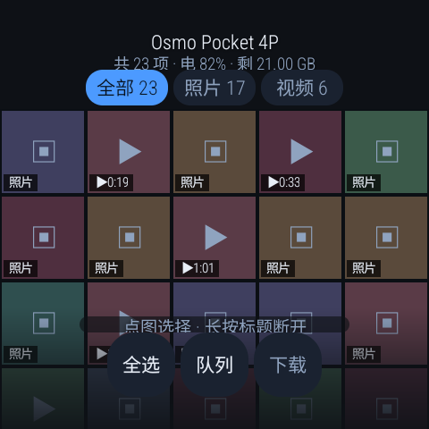
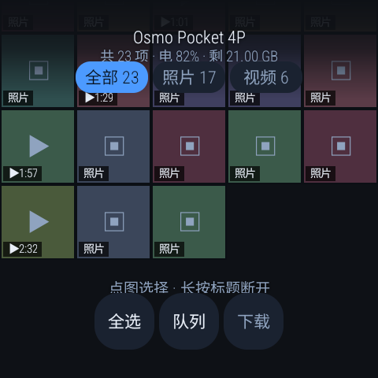

# OsmoWatch（大疆传片）—— Galaxy Watch7 手表版

把手表变成大疆 Osmo 相机的取片器：**连上相机 → 浏览相机里的照片/视频 → 下载到手表相册**。

- 目标设备：**三星 Galaxy Watch7（SM-L3150）**，Android 16 / API 36 / **32 位 armeabi-v7a** / 480×480 圆屏
- 目标相机：**大疆 Osmo Pocket 4P**（协议同时兼容 Pocket 4 / 3、Action 系列）
- 协议来源：[KonradIT/osmosis](https://github.com/KonradIT/osmosis)（**MIT**）——本项目把它的 Osmo 协议栈从 Kotlin 移植为纯 Java，并**自己写了一套圆屏 UI**
- 产物：`out\OsmoWatch.apk`，**无任何 native 库**，因此 32 位手表可直接跑

---

## 1. 为什么不是"精简 DJI Mimo"

这条路已经被实测证伪，不要再试：

| | DJI Mimo 2.12.1 | DJI Mimo（他人修改版）1.7.20 |
|---|---|---|
| 体积 | 1332 MB | 383 MB |
| 原生库架构 | **只有 arm64-v8a** | **只有 arm64-v8a** |
| 逐文件验证 | 184 个 `.so` 全是 ELF64 | 160 个 `.so` 全是 ELF64，**ELF32 = 0** |

而手表是**纯 32 位**：`abilist` 只有 `armeabi-v7a,armeabi`、`abilist64` 为空、`zygote32`、`/system/lib64` 与 `linker64` **都不存在**。
大疆自研的闭源协议栈（`libdjisdk_jni.so` 等）没有 32 位版本可用；历史上只有 2020 年的 Mimo 1.2.x 出过 `arm-v7a` 双架构版，那个年代不存在 Pocket 4P，协议完全对不上。

**所以唯一可行路线是：用纯 Java 重写协议栈 + 自绘手表 UI。本项目就是这条路。**

---

## 2. 目标设备的硬约束（都实测过）

| 项 | 值 | 对设计的影响 |
|---|---|---|
| 屏幕 | 480×480 px @340dpi ⇒ 逻辑仅 **225.9 dp** | 字号 7.5–16sp；主按钮 46dp、底部并排按钮 34dp |
| 屏幕形状 | 正圆，圆心 (240,240)，R=240 | 四角被面板物理切掉 |
| 圆形安全区 | `DisplayCutout.insets = Rect(0,0,0,0)`、`mRoundedCornerFrame = Rect(0,0,0,0)` | **系统不提供任何安全区**，只能自己按几何算 |
| ABI | `armeabi-v7a` | 不能引入任何 native 库 |
| 内存 | 1.8 GB | 缩略图必须限量（内存里最多 32 张，2 个下载线程） |
| root | 无 | 不能用 `run-as`、不能写系统分区 |
| 屏幕熄灭 | 厂商策略控制，`screen_off_timeout=0` 无效 | 传输必须靠前台服务 + WakeLock，不能依赖 Activity |
| 相机热点 | `192.168.2.1`，**无互联网**，WPA2-PSK，空闲约 10 秒掉线 | 必须 `bindProcessToNetwork`，必须有保活与重连 |

---

## 3. 数据流与分层

```
BleScanner ──扫描广播──▶ CameraInfo
   │
   ▼
BleSession ──DUML 帧（DumlFrame/Crc/Bytes/OsmoCommands）──▶ 配对 → 取 SSID/密码 → 唤醒热点
   │
   ▼
ApJoiner ──WifiNetworkSpecifier + bindProcessToNetwork──▶ 绑定到相机热点
   │
   ▼
Datalink ──UDP(9004/10004) + 8B udp hdr + 12B routing hdr──▶ devinfo/register/subscribe/清单
   │
   ▼
ManifestAssembler ──剥 10B 子头 + 拼接分片──▶ ManifestParser ──▶ List<MediaFile>
   │
   ▼
HttpFile ──GET /v2?storage&path，支持 HEAD/Range──▶ FileSaver ──▶ MediaStore（DCIM/OsmoWatch）
```

| 包 | 职责 | 能否桌面单测 |
|---|---|---|
| `com.watch.osmo.duml` | CRC8/CRC16、DUML 帧编解码、命令载荷 | ✅ 纯 Java |
| `com.watch.osmo.proto` | 媒体清单解析（CompositePack）、`MediaFile` | ✅ 纯 Java |
| `com.watch.osmo.net` | `HttpFile`（HTTP+Range）、`UdpPacket`/`Datalink`（UDP 数据链）、`ManifestAssembler` | ✅ 纯 Java；`ApJoiner`/`TransferService` 是 Android 层 |
| `com.watch.osmo.ble` | `BleAdvert`（解析，纯 Java）、`BleScanner`/`BleSession`（GATT，Android） | 解析可测 |
| `com.watch.osmo.core` | `OsmoClient` 状态机（把上面全串起来）、`CameraInfo`/`CameraStatus` | ❌ 需要 Android |
| `com.watch.osmo.store` | `FileSaver`（MediaStore 优先，App 目录兜底） | ❌ |
| `com.watch.osmo.ui` | `Round`（几何，纯 Java）、`RoundColumn`/`RoundList`/`Ui`、四个界面、`Thumbs` | 几何可测 |

`OsmoClient` 的所有回调都投递到主线程，界面可直接更新 View。

---

## 4. 目录结构

```
OsmoWatch\
  src\AndroidManifest.xml         权限、Activity、前台服务声明
  src\res\values\strings.xml      只有应用名（界面全部代码构建，无 XML 布局）
  src\java\com\watch\osmo\        见上表
  test\                           桌面 JVM 自测（每个都有 main()，不用 JUnit）
  reference\osmosis\              移植用的 MIT 参考实现（只读，未修改）
  build.ps1                       构建 + 签名
  run-tests.ps1                   跑全部桌面自测
  verify-on-watch.ps1             真机验收（会安装 APK，由使用者自己跑）
  out\OsmoWatch.apk               产物
```

---

## 5. 构建

### 前置条件

- **JDK 17+**：设 `JBR_HOME` 或 `JAVA_HOME`；不设则自动找 VS Code Java 扩展自带的 JBR（`%USERPROFILE%\.vscode\extensions\redhat.java-*`）
- **Android SDK**：需要 **build-tools 30.0.3** + **platforms/android-30**，用 `WATCH_OSMO_SDK` 指定（也认 `ANDROID_SDK_ROOT` / `ANDROID_HOME`）
- **r8.jar**：可选，用 `R8_JAR` 指定；缺省回退到 SDK 自带的 `d8.jar`
- **签名**：`%USERPROFILE%\.android\debug.keystore`（密码 `android`，别名 `androiddebugkey`），或用 `DEBUG_KEYSTORE` 指定

想把这些路径固定在本机又不想提交进仓库：把 `build.local.example.ps1` 复制成 `build.local.ps1` 填好即可，
`build.ps1` 会自动加载它，而它已经在 `.gitignore` 里。

### 跑

```powershell
powershell -NoProfile -ExecutionPolicy Bypass -File .\build.ps1
```

流程：`aapt2 compile` → `aapt2 link` → `javac --release 8` → `d8` → 打包 → `zipalign` → `apksigner`。

**两个本机坑，build.ps1 已经内置绕开：**

1. **中文路径**：`aapt2.exe` / `zipalign.exe` 按 ANSI 解释路径，且**可执行文件自身路径含中文就会让整条命令行错位**（实测 `zipalign` 会把输出文件当成输入）。脚本自动在 `%TEMP%` 建两个 junction（`wosmo-ascii` → 项目父目录、`wasdk30` → SDK），全程走纯 ASCII 路径。
2. **Java 版本**：脚本显式用 `--release 8`，让"只用 Java 8 API"成为**编译器校验的事实**，而不是一句承诺。

---

## 6. 桌面自测

```powershell
# 测试夹具来自上游 osmosis 仓库，需要先取一份（MIT，许可证副本见 THIRD_PARTY_LICENSES/）
git clone --depth 1 https://github.com/KonradIT/osmosis reference/osmosis
powershell -NoProfile -ExecutionPolicy Bypass -File .\run-tests.ps1
```

| 测试 | 结果 | 覆盖 |
|---|---|---|
| `DumlSelfTest` | ✅ 74/0 | CRC 双参数化交叉验证、DUML 帧编解码往返、配对/WiFi/会话命令的字节级结构 |
| `ManifestSelfTest` | ✅ 342/0 | **对着真机抓包验证清单解析**：`op4_45`（Pocket 4，45 条）逐字段对齐 golden，外加 14 个夹具回归、344 个健壮性用例 |
| `HttpSelfTest` | ✅ 91/0（挂 android.jar 后 117/0） | 自建 mock 相机：URL 转义、HEAD、`Range` 206、**断点续传后逐字节相等**、Range 被忽略时不写坏文件、并发上限 |
| `BleSelfTest` | ✅ 55/0 | **用真机广播样本**验证机型识别（含 Pocket 4P = 0x22） |
| `DatalinkSelfTest` | ⚠️ 317/**2** | UDP/routing 头、seq 规则、握手端口回退、清单切片；见下 |
| `PipelineSelfTest` | ✅ 74/0 | **端到端**：真机抓包 → 拆数据报 → 两条喂入路径 → 重组 → 解析 → 与 golden 逐字段 + 顺序比对 |
| `RoundGeometryTest` | ✅ 33 项全过 | 圆屏几何：`halfWidthAt`、行宽四角在圆内、RoundColumn 栈逐子控件校验、BrowseScreen 三个 band 四角在圆内 |

**DatalinkSelfTest 那 2 条失败**都落在"遥测"和"超出协议规格的健壮性"上，不在应用实际走的数据路径上：一条是把**单个 UDP 数据报拆成两半**分次喂入（UDP 语义上不可能发生），一条是 `subSeqFirst()` 遥测字段差 1。数据路径本身有三重独立证据（两条喂入路径逐字节一致、与参考实现的重组逐字节一致、74 条 golden 逐字段比对全过）。详见 [TEST-REPORT.md](TEST-REPORT.md)。

**这些测试覆盖不到的**（必须真机，脚本会明确打印）：BLE 广播接收、GATT 连接与 MTU 协商、配对确认、`WifiNetworkSpecifier` 入网、真实 UDP 数据链与保活、MediaStore 落盘、真机渲染与触控。

---

## 7. 装到手表并验收

> ✅ 已在 Galaxy Watch7（`192.168.1.50`）上装过并验证：启动、渲染、触控、滚动、BLE 真机扫描（扫到 6 个非相机设备并正确过滤）、错误处理、二级日志页全部正常。**真机上发现并修掉了 4 个只在设备上才现形的缺陷**，详见 [TEST-REPORT.md](TEST-REPORT.md) §8。
>
> ✅ 之后又跑通了完整链路到「列表 + 下载」：蓝牙配对 → 取热点凭据 → 入网 `192.168.2.118` → UDP 9004 握手 → 播放模式确认 → 9 个文件清单。两次真机缺陷（相机在拍摄模式下只吐部分清单；`targetSdk 30` 默认禁止明文 HTTP 导致相机 `/v2` 全部失败）已修复，见 TEST-REPORT §9。

```powershell
powershell -NoProfile -ExecutionPolicy Bypass -File .\verify-on-watch.ps1
```

脚本会：自动认设备（Watch7 走**无线调试的随机端口**，所以从 `adb devices` 取）→ 装 APK → `pm grant` 五个运行时权限 → 唤醒面板 → 启动 → 抓 `logcat -s OsmoWatch` 与截图到 `out\evidence\`。

### 界面（圆屏设计，v0.5）

| 相册（静止） | 相册（滑到底） |
|---|---|
|  |  |

> 截图来自 `--es preview grid` 预览模式（23 个假文件），不是真机相册内容。

| 页 | 布局 |
|---|---|
| 连接页 | 标题 / 副标题 / 状态 / **并排两个 186×118 按钮（扫描相机 · 自检日志）** / 三行日志 |
| 相册页 | **照片铺满整个表盘**（直角 5 列 96px 栅格，x=[0,480]，无间隙）→ 上面浮着「型号·数量 + 全部/照片/视频」条，下面浮着「已选 N 项 · 大小 + 全选/队列/下载」，两条都带**暗色渐变蒙版** |
| 传输页 | **屏幕最边缘的单条弧形进度环** + 中间 `N/M`、文件名、速度·剩余时间、字节数 + 取消按钮 |

- 栅格参考手机版大疆 App：**直角正方形、直接顶到屏幕左右边缘**。上下不再留固定 band，控件**浮在照片上**，照片可以一直铺到圆边。圆屏会切掉最外列的角——这是"满铺"的代价，`test/RoundGeometryTest` 因此改用两条判据：**每块中心必须在圆内**（否则点不到）、**每块至少 50% 可见**。实测次行最外块可见 96%，首行（在窄帽里）59% 但仍可点（中心 230.8 < 240）。
- **蒙版而不是模糊**：4 段色标 + 全透明收尾的 `GradientDrawable`。`RenderEffect` 模糊在这颗 5 核 Exynos 上等于每帧一次全屏离屏绘制，滚动会掉帧。
- **滚动留白：上 132px / 下 150px**（v0.2.3）。不是为了好看，是因为 y=0 处最外列格子的中心距圆心 271px > 240，**点不到**；留白让第一行和最后一行都能拖进圆最宽的地方。上 132 让首行落在页签（78–118）下方，下 150 让末行在滚到底时停在 y=330（按钮在 372–444），两头都不会被悬浮条压住。
- 短行（比如"视频"页只有 3 条）居中；多行时的末行**左对齐**，保证列对齐。
- 每块右下角小角标：照片 `照片`、视频 `▶0:19`；选中 = 2px 蓝框 + 右上角 ✓，不改尺寸。
- **三个底部按钮必须同尺寸同圆角**：之前下载按钮在每次选中时被单独重设成 20dp 圆角，另外两个是 11dp，看起来"一个圆的、一个方圆的"。现在三者都由同一个 `compactButton()` 造出来。
- 传输页**没有文件列表**：它是这一页所有布局事故的来源（UNSPECIFIED 高度把按钮推到弦宽只有 6px 的位置）。

**为什么是 5 列、96px**：480 / 5 = 96，正好整除、无间隙。3 列会浪费两侧，6 列每块只有 80px 且角标挤不下。改列数动 `BrowseScreen.COLUMNS / CELL_PX` 两个常量，并同步 `test/RoundGeometryTest`。

**布局预览（不用相机、不用连手表）**：

```powershell
adb shell am start -n com.watch.osmo/.ui.MainActivity --es preview grid    # 相册页，23 个假文件（铺满 5 行）
adb shell am start -n com.watch.osmo/.ui.MainActivity --es preview queue   # 传输页，假进度
```

相机没接的时候这两个页面本来根本到不了，而它们的历史缺陷（行宽算成 0、文字右侧被裁、按钮缩成一条）只有截图能看出来。`am force-stop` 一下再启动，`singleTop` 不会重新走 `onCreate`。

### 人工步骤（脚本做不了）

1. 相机开机、手表蓝牙打开，打开 App 点「扫描相机」→ 10 秒内应出现相机
2. 点相机条目 → 状态提示「**请在相机屏幕上点确认（显示 OSMO）**」→ 去相机屏幕上点确认
3. 手表会自动：取热点信息 → 唤醒相机热点（约 15 秒）→ 加入热点 → 建立数据链 → 拉取文件列表
4. 选文件 → 「下载选中(N)」→ 队列页看进度；成功后文件在 **`DCIM/OsmoWatch/`**（相册可见）

### 失败了怎么取证

```powershell
# 应用日志（logcat）
adb -s <IP:端口> logcat -d -v time -s OsmoWatch:V
# Wi-Fi 是否真的加入了相机热点
adb -s <IP:端口> shell "dumpsys wifi | grep -i -m20 'SSID\|state'"
# 截图（注意：熄屏时截图是全黑，约 2–5 KB，别误判成 App 黑屏）
adb -s <IP:端口> shell "screencap -p /sdcard/s.png"; adb -s <IP:端口> pull /sdcard/s.png .
```

App 内也有一份滚动日志（`Diag`，同时写 logcat 和 `files/osmo.log`），界面上的「自检 · 日志」可以直接看和导出。

---

## 8. 已知风险与未验证项

| # | 风险 | 状态 | 说明 |
|---|---|---|---|
| **R1** | **相机热点是 5.8 GHz**，手表支持的 Wi-Fi 频段**未实测** | ⚠️ **未验证，头号风险** | 若手表只支持 2.4 GHz，整条路线不通。拿到相机后第一件事：手表「设置 → 连接 → Wi-Fi」看能否搜到相机热点 |
| R2 | Wear OS 上 `WifiNetworkSpecifier` 可能弹系统确认框或被限制 | ⚠️ 未验证 | 失败时日志会写明；兜底是让用户手动到系统设置里连相机热点 |
| R3 | 手表 Wi-Fi 吞吐低（实测链路 72 Mbps，11n） | ⚠️ | 4K 视频传输会很慢，属正常；已做断点续传与空间预检 |
| R4 | `storage`（内置/SD）无法从抓包确定 | ⚠️ | 清单里的句柄位只是"猜测"；**代码里用真实 HTTP HEAD 探测**（`HttpFile.detectStorage`）来定，这个必须真机才能确认 |
| R5 | `0x00/0x26`、`0x00/0x81`、`0x00/0x88`、`0x00/0x99`、`0x03/0xDA` 的 **message id 是推测值** | ⚠️ | 载荷字节忠实移植；id 无从推导（参考实现用的是传输层序号）。若真机上相机不响应这些命令，**这里就是第一嫌疑** |
| R6 | Panic/异常路径覆盖有限 | ⚠️ | 解析器对垃圾输入不崩（344 个用例），但真实弱网下的重连时序只能真机检验 |
| R7 | 首次安装若是覆盖不同签名的旧版会失败 | — | 表上此前装的 `dev.konraditurbe.osmosis` 是**不同包名**，不冲突 |

---

## 9. 设计取舍（写下来免得以后重新试）

1. **不依赖 `WindowInsets` / `DisplayCutout`**：这台表上它们全是 0，等于没有。`Round` 直接用圆方程算。
2. **`RoundColumn`（静态界面）按每个控件的纵向位置收窄宽度**，所以设备页/队列页永远不会有控件出圆。
3. **`RoundList`（滚动列表）给所有行同一个宽度**（≈圆心上下 ±1/4 屏高处的可用宽度），而不是按行实时算：实时算会让手指拖动时每帧重新测量、在 5 核 SoC 上卡顿；用圆心宽度又会让首尾行的角出圆。折中 + 容器上下各留 96px 内边距，保证任何一行都能滚到中间宽区再读/点。
4. **绝不横排两个按钮**：实测参考实现（手机版 osmosis）在圆屏上右侧按钮被直接切掉，本项目所有界面都是单列。
5. **协议层保持纯 Java**：`duml` / `proto` / `net` 大部分不引用 Android API，才能在这台**没有手表、没有相机**的机器上用真机抓包做验证。
6. **存储双保险**：先写 MediaStore（`DCIM/OsmoWatch`），失败退回 App 私有目录——已经过网的文件不能因为相册写入失败而丢掉。

---

## 10. 许可与来源

- **本项目（OsmoWatch）以 [MIT](LICENSE) 许可发布，Copyright (c) 2026 ZGH271050。**
- 协议实现移植自 [KonradIT/osmosis](https://github.com/KonradIT/osmosis)，**MIT License, Copyright (c) 2026 Konrad Iturbe**，许可证副本见 `THIRD_PARTY_LICENSES/osmosis-LICENSE.txt`。
- CRC/DUML 帧实现源自 osmosis 内标注的 [dimadesu/dji-remote](https://github.com/dimadesu/dji-remote)（同样 MIT）。
- 使用或再分发时请同时保留上述第三方版权声明。

---

## 11. 更新记录

完整记录见 [CHANGELOG.md](CHANGELOG.md)（**最新在最上面**）。安装包发布在 [Releases](https://github.com/ZGH271050/DJI-Mimo-watch-app/releases)。

| 版本 | 日期 | 摘要 |
|---|---|---|
| v0.2.7 | 2026-11-21 | 机型名跟着实际相机走（不再写死 4P） |
| v0.2.6 | 2026-11-21 | 「取消连接」按钮真正生效 |
| v0.2.5 | 2026-11-21 | 机型名称统一为官方的 Pocket 4P |
| v0.2.4 | 2026-11-21 | 照片铺满整屏（修 ScrollView padding 裁剪） |
| v0.2.3 | 2026-11-21 | 能滑到底、缩略图续载、边缘渐变 |
| v0.2.2 | 2026-11-21 | 相册顶部安全区 + 手动清理缓存与日志 |
| v0.2.1 | 2026-11-21 | 存储卫生：日志上限减半、清理半截下载 |
| v0.2.0 | 2026-11-21 | 修相机固件更新后「几十次才连上一次」 |
| v0.1.0 | 2026-10-11 | 首个可运行版本 |
